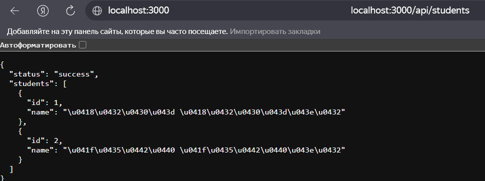
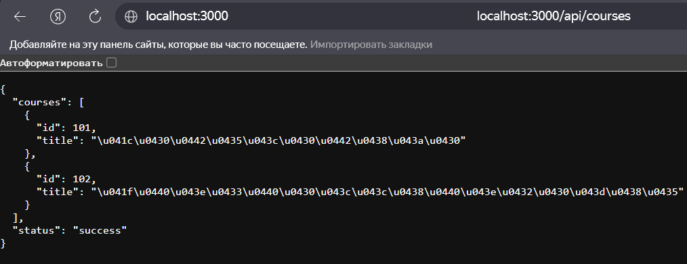
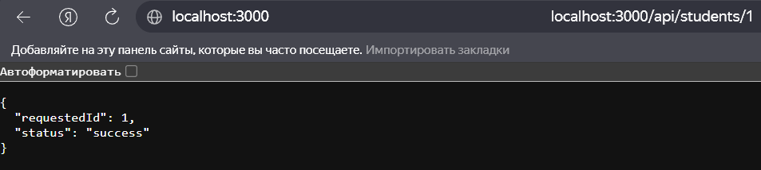
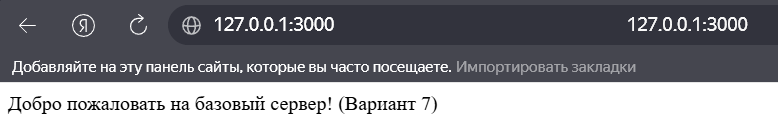
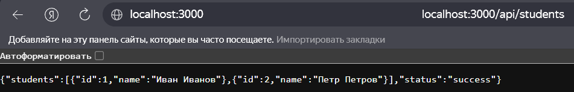
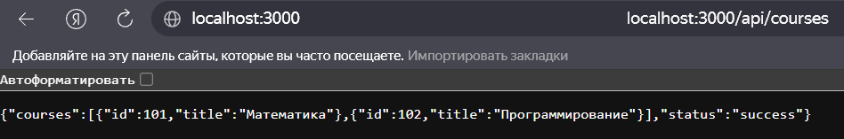
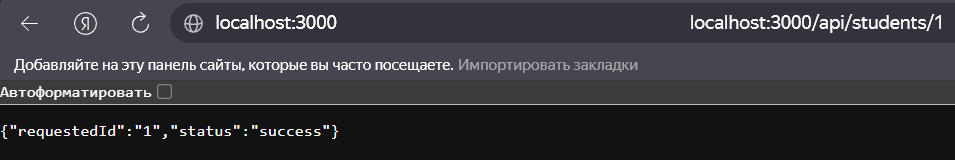

# Лабораторная работа №1: Настройка среды разработки и первый HTTP-сервер

**Студент:** Слукин Юрий Алексеевич
**Группа:** ПИЖ-б-о-25-2
**Вариант:** 7 (Повышенный уровень)
**Технологии:** Python + Flask, Node.js + Express

## Содержание
- [Лабораторная работа №1: Настройка среды разработки и первый HTTP-сервер](#лабораторная-работа-1-настройка-среды-разработки-и-первый-http-сервер)
  - [Содержание](#содержание)
  - [Цель работы](#цель-работы)
  - [Теоретическое обоснование](#теоретическое-обоснование)
  - [Выполнение индивидуального задания (Python + Flask)](#выполнение-индивидуального-задания-python--flask)
    - [Результаты проверки (Flask)](#результаты-проверки-flask)
  - [Выполнение индивидуального задания (Node.js + Express)](#выполнение-индивидуального-задания-nodejs--express)
    - [Результаты проверки (Node.js)](#результаты-проверки-nodejs)
  - [Контрольные вопросы](#контрольные-вопросы)
  - [Вывод](#вывод)
  - [Список использованных источников](#список-использованных-источников)

## Цель работы

Освоить установку инструментов для бэкенд-разработки, создать и запустить минимальный веб-сервер, обрабатывающий GET-запросы, понять концепцию эндпоинтов, научиться настраивать автоматический перезапуск сервера.

## Теоретическое обоснование

**Клиент-серверная архитектура** — модель взаимодействия, при которой клиент (браузер, мобильное приложение) отправляет HTTP-запросы, а сервер обрабатывает их и возвращает ответы. Бэкенд-разработка отвечает за серверную логику, маршрутизацию и формирование данных.

**Эндпоинты и маршруты.** Эндпоинт — это конкретный URL-адрес вместе с методом HTTP (например, `GET /api/students`), по которому клиент запрашивает данные. Маршрут — это правило на сервере, которое сопоставляет URL с конкретной функцией-обработчиком.

**JSON** (JavaScript Object Notation) — текстовый формат обмена данными, ставший стандартом для REST API. Для автоматического перезапуска сервера при изменении кода в Node.js используется утилита `nodemon`, а во Flask — встроенный режим отладки (`debug=True`).

---

## Выполнение индивидуального задания (Python + Flask)

**Требования 7 варианта (Повышенный уровень):**
1. 5 эндпоинтов: 1 текстовый (`/`), 2 простых JSON-эндпоинта (`/api/students`, `/api/courses`), 1 JSON с параметром в пути (`/api/students/:id`), 1 обработчик 404.
2. Автоматический перезапуск (`debug=True`).
3. Консольное логирование запросов (метод + URL + время).

**Код сервера (`app.py`):**
```python
from flask import Flask, jsonify, request
import time

app = Flask(__name__)

# --- Реализация простого консольного логирования ---
@app.before_request
def log_request():
    print(f"[{time.strftime('%Y-%m-%d %H:%M:%S')}] {request.method} {request.path}")

# --- 1. Текстовый эндпоинт ---
@app.route('/')
def home():
    return 'Добро пожаловать на базовый сервер! (Вариант 7)'

# --- 2. Простой JSON-эндпоинт 1 ---
@app.route('/api/students')
def get_students():
    return jsonify({
        "students": [
            {"id": 1, "name": "Иван Иванов"},
            {"id": 2, "name": "Петр Петров"}
        ],
        "status": "success"
    })

# --- 3. Простой JSON-эндпоинт 2 ---
@app.route('/api/courses')
def get_courses():
    return jsonify({
        "courses": [
            {"id": 101, "title": "Математика"},
            {"id": 102, "title": "Программирование"}
        ],
        "status": "success"
    })

# --- 4. JSON-эндпоинт с параметром в пути ---
@app.route('/api/students/<int:student_id>')
def get_student_by_id(student_id):
    return jsonify({
        "requestedId": student_id,
        "status": "success"
    })

# --- 5. Обработчик 404 ---
@app.errorhandler(404)
def not_found(error):
    return jsonify({"error": "Маршрут не найден"}), 404

if __name__ == '__main__':
    app.run(port=3000, debug=True)
```

**Запуск:** `python app.py`. Благодаря `debug=True` сервер автоматически перезапускается при изменении кода.

### Результаты проверки (Flask)

<details>
<summary><b>1. <code>http://localhost:3000/</code> - Текстовый ответ.</b></summary>


</details>

<details>
<summary><b>2. <code>http://localhost:3000/api/students</code> - JSON со списком студентов.</b></summary>



</details>

<details>
<summary><b>3. <code>http://localhost:3000/api/courses</code> - JSON со списком курсов.</b></summary>



</details>

<details>
<summary><b>4. <code>http://localhost:3000/api/students/1</code> - JSON с параметром.</b></summary>



</details>

## Выполнение индивидуального задания (Node.js + Express)

Для сравнения подходов реализуем тот же функционал на Node.js.

**Код сервера (`app.js`):**

```javascript
const express = require('express');
const app = express();
const port = 3000;

// Консольное логирование каждого запроса (для продвинутого уровня)
app.use((req, res, next) => {
    console.log(`[${new Date().toISOString()}] ${req.method} ${req.url}`);
    next();
});

// 1. Текстовый эндпоинт
app.get('/', (req, res) => {
    res.send('Добро пожаловать на базовый сервер! (Вариант 7)');
});

// 2. Простой JSON-эндпоинт 1 (Коллекция Студенты)
app.get('/api/students', (req, res) => {
    res.json({
        students: [
            { id: 1, name: "Иван Иванов" },
            { id: 2, name: "Петр Петров" }
        ],
        status: "success"
    });
});

// 3. Простой JSON-эндпоинт 2 (Коллекция Курсы)
app.get('/api/courses', (req, res) => {
    res.json({
        courses: [
            { id: 101, title: "Математика" },
            { id: 102, title: "Программирование" }
        ],
        status: "success"
    });
});

// 4. JSON-эндпоинт с параметром в пути (ID студента)
app.get('/api/students/:id', (req, res) => {
    res.json({
        requestedId: req.params.id,
        status: "success"
    });
});

// Обработка 404 (для среднего и продвинутого уровня)
app.use((req, res) => {
    res.status(404).json({ error: 'Маршрут не найден' });
});

app.listen(port, () => {
    console.log(`Сервер запущен на http://localhost:${port}`);
});
```

**Запуск:** `node .\app.js`.

### Результаты проверки (Node.js)

<details>
<summary><b>1. <code>http://localhost:3000/</code> - Текстовый ответ.</b></summary>



</details>

<details>
<summary><b>2. <code>http://localhost:3000/api/students</code> - JSON со списком студентов.</b></summary>



</details>

<details>
<summary><b>3. <code>http://localhost:3000/api/courses</code> - JSON со списком курсов.</b></summary>



</details>

<details>
<summary><b>4. <code>http://localhost:3000/api/students/1</code> - JSON с параметром.</b></summary>



</details>

## Контрольные вопросы

1. **Что такое клиент-серверная архитектура?**
   Это модель взаимодействия в сети, где клиент (браузер, приложение) отправляет запросы, а сервер принимает их, обрабатывает и возвращает ответ.

2. **Какой протокол используется для общения клиента и сервера в вебе?**
   HTTP (HyperText Transfer Protocol).

3. **Что такое эндпоинт (endpoint)?**
   Это конкретная точка входа в API — комбинация URL-адреса и HTTP-метода (например, `GET /api/students`), по которой клиент обращается к серверу.

4. **Какую структуру имеет HTTP-запрос и HTTP-ответ? Что такое код состояния (status code)?**
   Запрос состоит из метода, URL, заголовков (headers) и тела (body). Ответ имеет аналогичную структуру плюс код состояния. Код состояния (например, 200 OK, 404 Not Found) — трехзначное число, указывающее результат обработки запроса.

5. **Что такое JSON? Почему он популярен в веб-разработке?**
   JSON (JavaScript Object Notation) — текстовый формат обмена данными. Популярен из-за легковесности, простоты чтения и нативной поддержки в JavaScript.

6. **Как запустить сервер на Node.js или Flask?**
   В Node.js: `node app.js` или `nodemon app.js`. Во Flask: `python app.py`.

7. **Что такое автоматический перезапуск сервера и зачем он нужен? Какой пакет используется для Node.js?**
   Это функция, которая отслеживает изменения в файлах и перезапускает сервер. Экономит время. В Node.js используется пакет `nodemon`.

8. **Какие коды состояния HTTP вы знаете? За что отвечает код 404?**
   Группы: 2xx (Успех), 3xx (Перенаправление), 4xx (Ошибка клиента), 5xx (Ошибка сервера). Код 404 означает, что запрашиваемый ресурс (URL) не найден на сервере.

9. **Что такое middleware в Express / декораторы запросов во Flask?**
   В Express это функции, выполняемые до обработчика маршрута (для логирования, парсинга и т.д.). Во Flask аналогом служат декораторы вроде `@app.before_request`, которые выполняются перед каждым запросом.

10. **Как получить параметр из URL-пути в вашем фреймворке?**
    В Express: через двоеточие в маршруте `app.get('/students/:id')` и обращение `req.params.id`. Во Flask: через угловые скобки `@app.route('/students/<int:student_id>')` и передачу аргумента в функцию.

## Вывод

В ходе лабораторной работы были настроены среды для бэкенд-разработки на двух стеках: Python + Flask и Node.js + Express. Реализован минимальный HTTP-сервер с маршрутизацией. Для 7 варианта (Повышенный уровень) созданы 5 эндпоинтов, включая обработку 404 и параметризированные запросы (поиск по ID студента). Настроен автоматический перезапуск (через `debug=True` во Flask и `nodemon` в Node.js) и консольное логирование запросов. Оба сервера успешно протестированы в браузере.

## Список использованных источников

1. **Node.js официальная документация** — https://nodejs.org/en/docs/
2. **Express официальная документация** — https://expressjs.com/
3. **Flask официальная документация** — https://flask.palletsprojects.com/
4. **HTTP протокол (MDN)** — https://developer.mozilla.org/ru/docs/Web/HTTP
5. **JSON (MDN)** — https://developer.mozilla.org/ru/docs/Web/JavaScript/Reference/Global_Objects/JSON
6. **Nodemon документация** — https://nodemon.io/