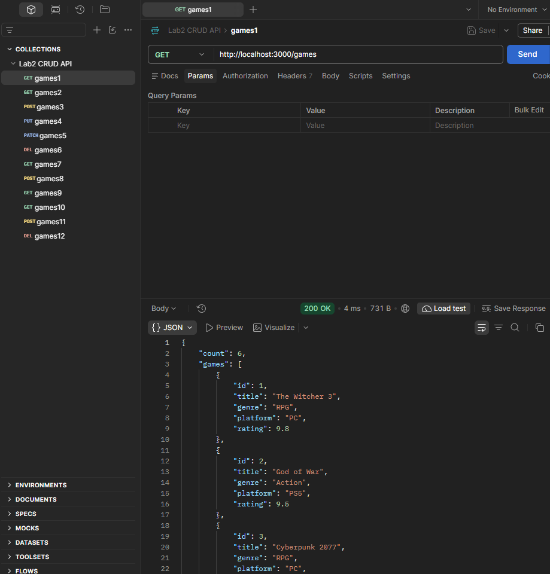
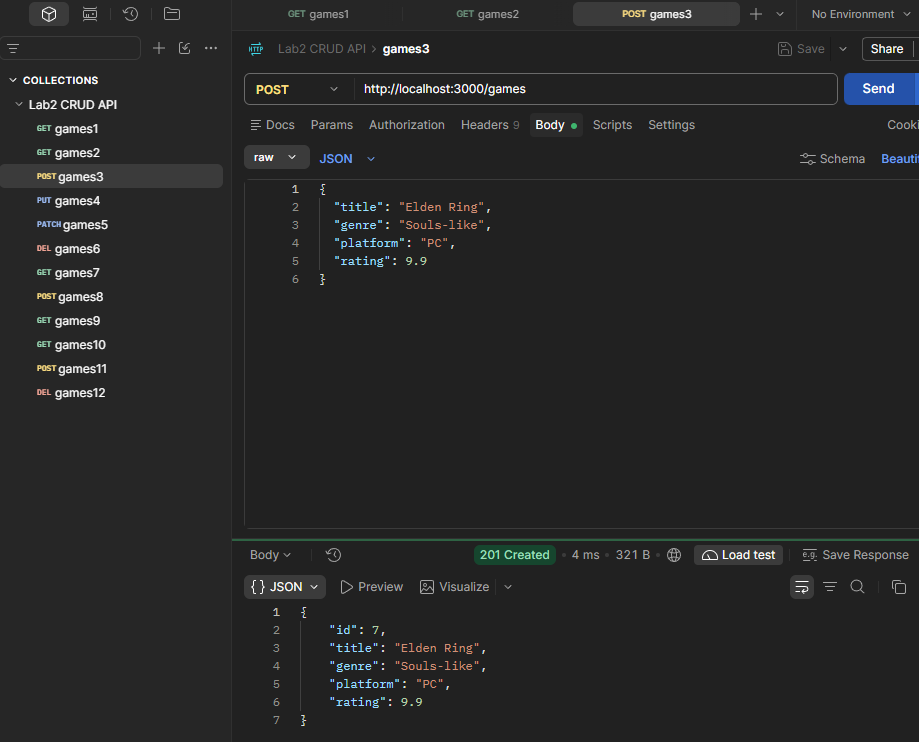
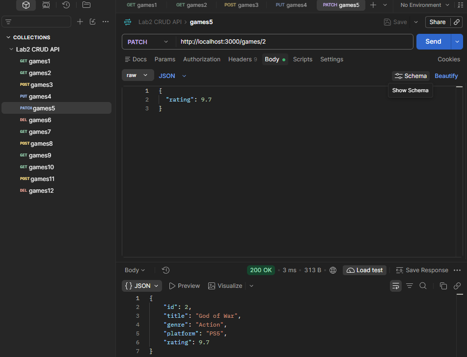
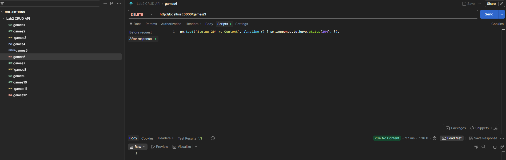
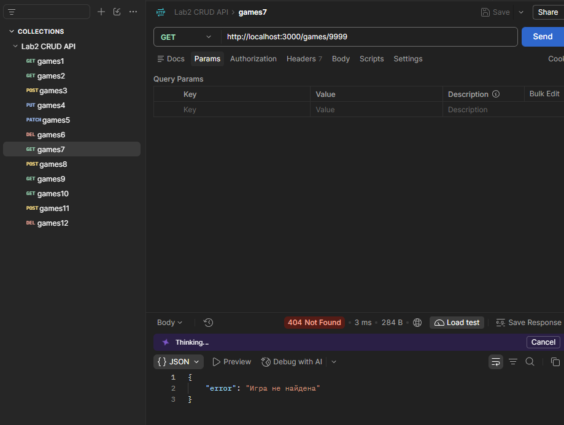
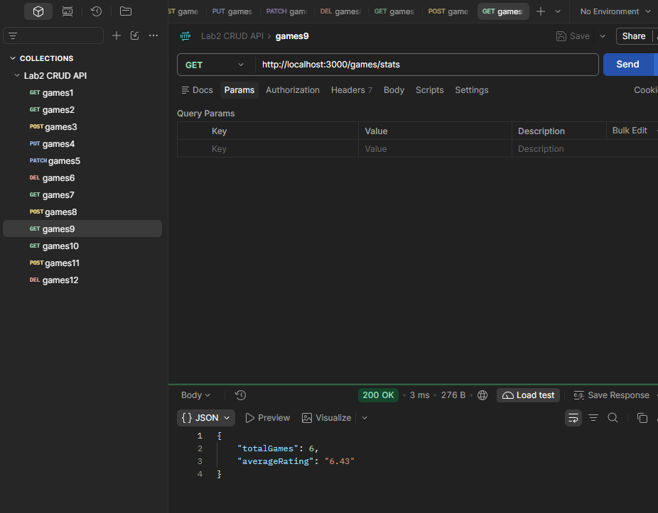
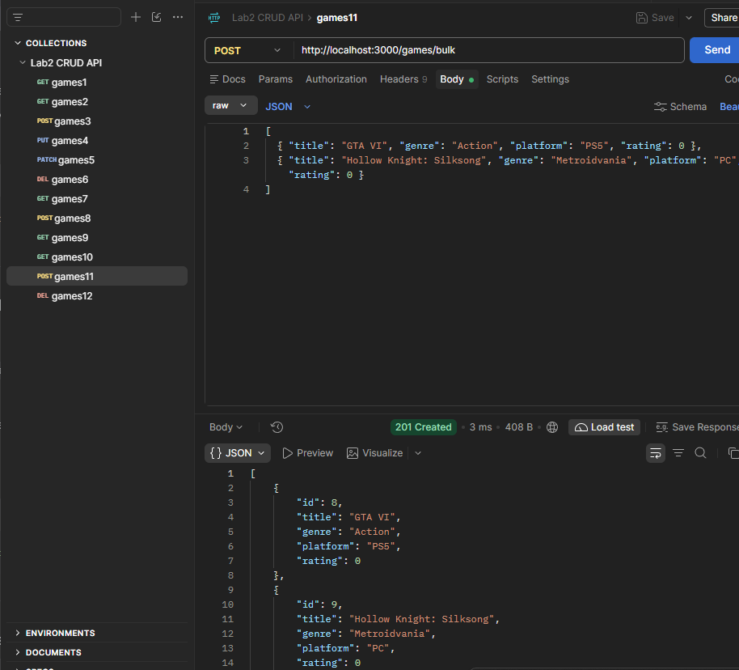

# Лабораторная работа №2: HTTP-методы: обработка GET, POST, PUT, DELETE

**Студент:** Слукин Юрий Алексеевич
**Группа:** ПИЖ-б-о-25-2
**Технология:** Node.js + Express
**Вариант:** 12 (Продвинутый уровень)

## Содержание
- [Лабораторная работа №2: HTTP-методы: обработка GET, POST, PUT, DELETE](#лабораторная-работа-2-http-методы-обработка-get-post-put-delete)
  - [Содержание](#содержание)
  - [Цель работы](#цель-работы)
  - [Теоретическое обоснование](#теоретическое-обоснование)
  - [Постановка задачи (Вариант 12)](#постановка-задачи-вариант-12)
  - [Ключевые фрагменты кода](#ключевые-фрагменты-кода)
  - [Результаты работы (Postman)](#результаты-работы-postman)
  - [Контрольные вопросы](#контрольные-вопросы)
  - [Вывод](#вывод)

## Цель работы

Освоить обработку различных HTTP-методов (GET, POST, PUT, DELETE) в Express. Научиться реализовывать CRUD-операции над коллекцией объектов, хранящейся в памяти сервера, а также возвращать корректные HTTP-коды ответов (200, 201, 204, 400, 404).

## Теоретическое обоснование

**CRUD** — акроним, обозначающий четыре базовые операции над данными:
*   **Create (Создание)** — POST.
*   **Read (Чтение)** — GET.
*   **Update (Обновление)** — PUT / PATCH.
*   **Delete (Удаление)** — DELETE.

**Идемпотентность** — свойство метода, при котором повторный вызов дает тот же результат, что и первый. GET, PUT, DELETE — идемпотентны. POST — нет.

**Коды состояния HTTP:** 200 OK (успех), 201 Created (создано), 204 No Content (успешно удалено), 400 Bad Request (ошибка клиента), 404 Not Found (не найдено), 500 Internal Server Error (ошибка сервера).

## Постановка задачи (Вариант 12)

Реализовать CRUD API для сущности **«Игры» (games)**. 
**Продвинутый уровень (Комплект 3) требует:**
1. Базовые CRUD операции.
2. Валидацию данных (400).
3. Поиск, сортировку и пагинацию.
4. Частичное обновление (PATCH).
5. Массовое удаление и создание.
6. Статистику (`/games/stats` — средний рейтинг).
7. Связанные элементы (`/games/:id/related` — по платформе).
8. Логирование запросов в файл `access.log`.

## Ключевые фрагменты кода

**1. Логирование в файл (Middleware):**
```javascript
app.use((req, res, next) => {
    const logLine = `[${new Date().toISOString()}] ${req.method} ${req.url}\n`;
    fs.appendFileSync('access.log', logLine);
    console.log(logLine.trim());
    next();
});
```

**2. Правильный порядок маршрутов (чтобы stats не принимался за :id):**
```javascript
// Статические маршруты идут ПЕРВЫМИ
app.get('/games', (req, res) => { /* ... */ });
app.get('/games/stats', (req, res) => { /* ... */ });
app.post('/games/bulk', (req, res) => { /* ... */ });
app.delete('/games', (req, res) => { /* ... */ });

// Динамические маршруты идут ПОСЛЕ
app.get('/games/:id', (req, res) => { /* ... */ });
app.get('/games/:id/related', (req, res) => { /* ... */ });
app.put('/games/:id', (req, res) => { /* ... */ });
app.patch('/games/:id', (req, res) => { /* ... */ });
app.delete('/games/:id', (req, res) => { /* ... */ });
```

**3. Частичное обновление (PATCH) с оператором spread:**
```javascript
app.patch('/games/:id', (req, res) => {
    const index = games.findIndex(g => g.id === parseInt(req.params.id));
    if (index === -1) return res.status(404).json({ error: 'Игра не найдена' });
    
    games[index] = { ...games[index], ...req.body }; // Обновляем только переданные поля
    res.json(games[index]);
});
```

**4. Статистика и связанные элементы:**
```javascript
app.get('/games/stats', (req, res) => {
    if (games.length === 0) return res.json({ averageRating: 0 });
    const sum = games.reduce((acc, g) => acc + g.rating, 0);
    res.json({ totalGames: games.length, averageRating: (sum / games.length).toFixed(2) });
});

app.get('/games/:id/related', (req, res) => {
    const game = games.find(g => g.id === parseInt(req.params.id));
    if (!game) return res.status(404).json({ error: 'Игра не найдена' });
    const related = games.filter(g => g.platform === game.platform && g.id !== game.id);
    res.json({ platform: game.platform, related });
});
```

## Результаты работы (Postman)

В ходе выполнения работы была создана коллекция `Lab2 CRUD API`, содержащая 11 запросов, покрывающих все требования варианта. Для каждого запроса были написаны автотесты (вкладка Scripts -> After response).

**Результат Collection Runner:**
<details>
<summary><b><code>Tests</code></b></summary>


</details>

**Ключевые результаты проверки:**
*   `GET /games` — 200 OK, JSON со списком игр.

*   `POST /games` — 201 Created, JSON с новой игрой.

*   `PATCH /games/2` — 200 OK, изменено только переданное поле.

*   `DELETE /games/3` — 204 No Content (пустой ответ).

*   `GET /games/999` — 404 Not Found.

*   `GET /games/stats` — 200 OK, средний рейтинг 6.43.

*   `POST /games/bulk` — 201 Created, массив новых игр.


## Контрольные вопросы

1. **Что такое CRUD? Расшифруйте каждую букву.**
   Create (Создание), Read (Чтение), Update (Обновление), Delete (Удаление).

2. **Какие HTTP-методы соответствуют операциям CRUD?**
   POST, GET, PUT/PATCH, DELETE.

3. **Что такое идемпотентность? Какие методы идемпотентны?**
   Свойство, при котором повторный запрос не меняет результат. GET, PUT, DELETE — идемпотентны. POST — нет.

4. **Какой код ответа возвращается при успешном создании ресурса (POST)?**
   201 Created.

5. **Какой код ответа возвращается при успешном удалении ресурса?**
   204 No Content.

6. **Что такое middleware в Express?**
   Функции, которые выполняются до обработчика маршрута (для логирования, парсинга, валидации).

7. **Как получить параметры из тела POST-запроса в Express?**
   Через `req.body` (обязательно подключить `app.use(express.json())`).

8. **Как получить параметр из URL?**
   Через `req.params` (например, `req.params.id`).

9. **Как найти элемент в массиве по ID?**
   `array.find(item => item.id === id)`.

10. **Какой код ответа возвращается, если ресурс не найден?**
    404 Not Found.

11. **Как отправить JSON-ответ в Express?**
    `res.json(data)`.

12. **Как вернуть статус-код 201 в Express?**
    `res.status(201).json(data)`.

13. **Что произойдёт с данными в памяти при перезапуске сервера?**
    Они удалятся, так как массив обнулится.

14. **Как добавить новый элемент в массив?**
    `array.push(newItem)`.

15. **Как удалить элемент из массива?**
    `array.splice(index, 1)`.

16. **В чём разница между PUT и PATCH?**
    PUT заменяет ресурс целиком, PATCH обновляет только переданные поля.

17. **Как реализовать поиск по коллекции?**
    Фильтрация через `array.filter(...)` с использованием `req.query.search`.

18. **Как реализовать сортировку по полю?**
    `array.sort((a, b) => a[field] > b[field] ? 1 : -1)`.

19. **Как реализовать пагинацию?**
    Срез массива: `array.slice((page - 1) * limit, page * limit)`.

20. **Как валидировать входные данные?**
    Проверка на наличие обязательных полей и их типов, возврат 400 при ошибке.

21. **Какие коды ответов используются при ошибках валидации?**
    400 Bad Request.

22. **Как вернуть 204 No Content при DELETE?**
    `res.status(204).send()`.

23. **В чём разница между `res.json()` и `res.send()`?**
    `res.json()` ставит Content-Type: application/json, `res.send()` отправляет данные как есть.

24. **Как избежать дублирования ID?**
    Использовать глобальный счетчик `nextId++`.

25. **Что такое `express.json()` и почему без него `req.body` пустой?**
    Это middleware для парсинга JSON. Без него `req.body` будет `undefined`.

## Вывод

В ходе лабораторной работы был освоен механизм обработки HTTP-методов в Express. Для варианта 12 была реализована полноценная CRUD-система для управления коллекцией игр с хранением данных в памяти. В рамках продвинутого уровня были реализованы частичное обновление (PATCH), массовые операции, статистика, связи между элементами и логирование запросов в файл. Все эндпоинты успешно протестированы в Postman с использованием Collection Runner (13 тестов пройдено успешно).